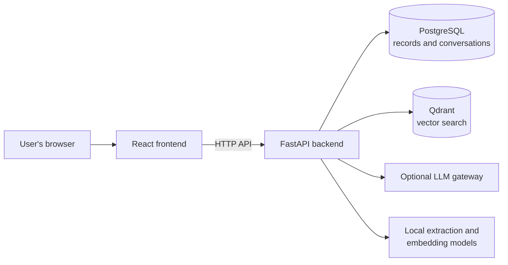

# Atlas — Document Intelligence Platform

Atlas is a document question-answering application. Users upload documents, search their contents, and ask questions in a web chat. Answers are generated from retrieved passages and include citations so users can check the source.

This repository contains the web frontend, Python API, document processing and retrieval pipeline, and local Docker setup.

## What it does

- Extracts text from PDF, DOCX, TXT, Markdown, HTML, and common image files. OCR is used for scanned pages and images.
- Splits extracted text into searchable chunks and keeps source information such as document and page where available.
- Searches with both semantic vector search and BM25 keyword search. Hybrid mode combines their rankings with Reciprocal Rank Fusion (RRF); a cross-encoder can rerank candidates.
- Uses a configurable OpenAI-compatible LLM endpoint to draft cited answers. Citation checks can reject unsupported answers and abstain when evidence is insufficient.
- Stores document records and chat history in PostgreSQL, and vector embeddings in Qdrant.
- Provides a React web interface for sign-in, document management, search, chat, citations, and feedback.

## How the pieces connect



PostgreSQL and Qdrant have different jobs: PostgreSQL stores structured application data; Qdrant finds document chunks by semantic similarity. The LLM gateway is optional for uploads and search, but needed for generated chat answers.

## Technology

Python, FastAPI, SQLAlchemy, PostgreSQL, Alembic, Qdrant, Sentence Transformers, BM25, Reciprocal Rank Fusion, cross-encoder reranking, PyMuPDF, python-docx, Tesseract OCR, React, TypeScript, Vite, Docker Compose, pytest, and Ruff.

## Run locally with Docker

This is the simplest way to start the backend and its supporting databases together. Docker Compose starts its own PostgreSQL and Qdrant containers; these are separate from any PostgreSQL installation or Qdrant Cloud cluster you already use.

### 1. Install prerequisites

- [Docker Desktop](https://www.docker.com/products/docker-desktop/) with Docker Compose.
- [Node.js](https://nodejs.org/) for the frontend.
- Git, if cloning the repository.

### 2. Get the code and create local configuration

```powershell
git clone <your-repository-url>
cd <repository-folder>
if (!(Test-Path backend/.env)) { Copy-Item backend/.env.example backend/.env }
```

`backend/.env` is local configuration and should not be committed. The example defaults are for local development. This command leaves an existing `.env` untouched. Chat stays disabled until you configure an LLM provider and model; the API key belongs only in this backend environment file.

### 3. Start the API and databases

Make sure Docker Desktop is running, then from the repository root:

```powershell
docker compose up --build -d
docker compose ps
```

Compose builds the backend image, starts PostgreSQL and Qdrant, applies Alembic database migrations, and then starts FastAPI. The backend is available at `http://localhost:8001`. By default, Compose uses its local Qdrant container and routes gateway requests to a gateway running on your computer at port `8000`. To use Qdrant Cloud or a separately hosted gateway, put `QDRANT_URL` and/or `DOCKER_LLM_GATEWAY_BASE_URL` in `backend/.env` and start Compose with `docker compose --env-file backend/.env up --build -d`. The Qdrant key remains in `backend/.env` as `QDRANT_API_KEY`.

Open `http://localhost:8001/docs` for the API documentation, `http://localhost:8001/health` for the health endpoint, and `http://localhost:8001/ready` to check database connectivity.

> **Port conflict:** If PostgreSQL already installed on your computer is using port `5432`, Docker cannot publish its own PostgreSQL container on that port. Stop the local PostgreSQL service while using the default Compose setup, or use the local-backend setup below. The Docker database has its own data; it does not automatically use or copy your installed PostgreSQL database.

### 4. Start the frontend

Open a second terminal:

```powershell
cd frontend
npm ci
npm run dev
```

Open the local URL printed by Vite, usually `http://localhost:5173`. In development, Vite forwards API requests to the backend on port `8001`.

### 5. Stop Docker services

From the repository root:

```powershell
docker compose down
```

This stops the containers and keeps data in Docker volumes. `docker compose down -v` also deletes the Docker database, Qdrant data, uploaded files, and model cache.

## Run the backend with a local PostgreSQL installation

Use this option if you want the backend in a Python virtual environment and want it to connect to PostgreSQL installed on your computer. You can use Qdrant Cloud or run only Qdrant with Docker.

### 1. Create and install the Python environment

In PowerShell, from the repository root:

```powershell
if (!(Test-Path backend/.env)) { Copy-Item backend/.env.example backend/.env }
cd backend
py -3.12 -m venv .venv
.\.venv\Scripts\Activate.ps1
python -m pip install -r requirements-dev.txt
```

If PowerShell blocks environment activation, you can skip activation and call `backend\.venv\Scripts\python.exe` directly from the repository root.

### 2. Configure PostgreSQL and Qdrant

Edit `backend/.env` and set `DATABASE_URL` to your PostgreSQL connection details. For example:

```text
DATABASE_URL=postgresql+psycopg://<username>:<password>@localhost:5432/<database_name>
```

Replace the placeholders with the PostgreSQL user, password, and database you created. Keep the real password private. To use Qdrant Cloud, set `QDRANT_URL` to your cluster URL and `QDRANT_API_KEY` to its key. Alternatively, start local Qdrant from the repository root with `docker compose up -d qdrant`, and use `QDRANT_URL=http://localhost:6333`.

### 3. Apply database migrations and run the API

From the `backend` directory, with `.venv` active:

```powershell
alembic upgrade head
python -m uvicorn app.main:app --reload --host 127.0.0.1 --port 8001
```

Then start the frontend in another terminal using the commands in the Docker setup above.

## Configure chat and Google sign-in

Both are optional for local development.

- **Chat:** Set `LLM_PROVIDER=openai_compatible`, the gateway base URL, API key, model ID, and available model IDs in `backend/.env`. Never put provider secrets in frontend variables or commit them to Git. Upload and search can work without an LLM provider.
- **Google sign-in:** Configure `GOOGLE_CLIENT_ID`, `GOOGLE_CLIENT_SECRET`, and `GOOGLE_REDIRECT_URI` in `backend/.env`. For local development, the callback URL is `http://localhost:8001/api/v1/auth/google/callback`. Add the exact frontend origin and callback URL to your Google OAuth client configuration.

## Useful commands

Run these from the repository root unless noted otherwise.

```powershell
# Follow backend logs when using Docker
docker compose logs -f backend

# Build the frontend for deployment
cd frontend
npm run build

# Run backend tests
cd ../backend
python -m pytest -q

# Check backend formatting and lint
python -m ruff check app tests alembic
```

Uploaded files and database/vector data need persistent storage in deployment. The local Compose volumes are for development and are not a backup strategy. See [docs/architecture.md](docs/architecture.md) for more technical design details.

## Security notes

- Never commit `.env` files, passwords, API keys, OAuth secrets, or real company documents.
- Rotate any credential that was accidentally exposed in a public repository or shared transcript.
- Configure production HTTPS, allowed frontend origins, hostnames, authentication, persistent file storage, and backups before hosting real or confidential documents.
- The default Compose credentials are for local development only.
